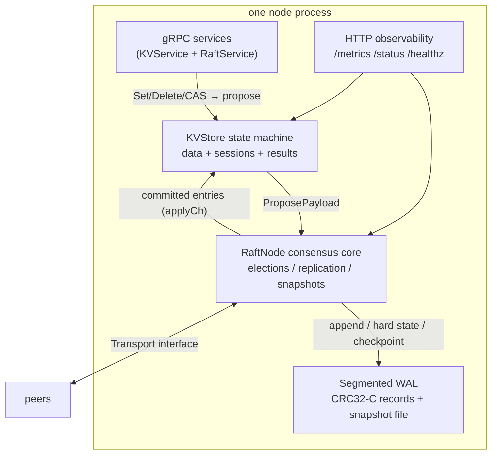
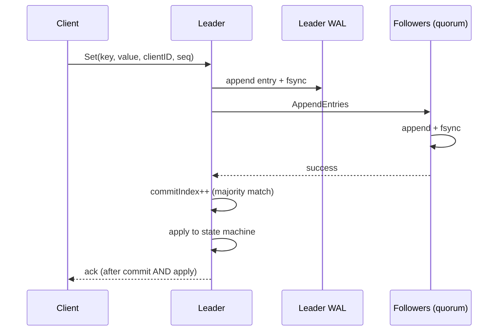

# Architecture

A fault-tolerant, linearizable key-value store built on a from-scratch Raft
implementation. This document describes the moving parts and the design
decisions behind them.

## Component map



The consensus core never touches gRPC directly: all peer I/O goes through the
`Transport` interface ([raft/transport.go](../raft/transport.go)). Production
uses the gRPC implementation; the chaos test suite plugs in an in-memory
network with fault injection.

## Write path



Acknowledgements are sent only after the entry is committed **and** applied
(`StrictApplyAcks`), so a successful `Set` is immediately visible to a
subsequent read on the leader. The proposer additionally verifies that the
entry committed *in its own term* — after a leadership change, a different
entry from a newer term can occupy the same index, and acking it would be a
false positive.

## Storage engine

Persistence is a segmented, append-only write-ahead log
([raft/wal.go](../raft/wal.go)) — not a rewrite-the-world JSON file. Every
record is framed as:

```
[u32 length][u32 CRC32-C][payload]
```

Record types:

| Type | Contents | Sync policy |
|------|----------|-------------|
| hard state | term, votedFor, commitIndex | fsync (except commit-only hints) |
| entries | log append batch; first index implicitly truncates the old suffix | fsync |
| snap meta | snapshot index + term; compacts the log prefix | fsync |

Design properties:

- **O(delta) appends.** A proposal writes one entries record and one fsync,
  regardless of log size.
- **Commit-index hints are unsynced.** Raft does not require commitIndex
  durability for safety; the hint is made durable by the next synced record's
  fsync and merely accelerates recovery.
- **Torn-write recovery.** A truncated or corrupt record at the tail of the
  *last* segment is treated as an interrupted write and dropped. Corruption
  anywhere else fails recovery loudly.
- **Checkpointing.** Snapshots write the state-machine image to
  `snapshot.snap` (tmp + fsync + rename), then start a fresh segment holding
  the complete current state, then delete old segments. Every crash point is
  safe: the snapshot file is written first, so when it is ahead of the WAL it
  is authoritative; leftover stale segments are superseded on replay.
- **Boot-time compaction.** Recovery always ends with a checkpoint, so every
  boot starts from a compact, verified baseline — and the recovery path is
  exercised on every start, not just after crashes.
- **Migration.** A legacy `raft-state.json` from the previous storage format
  is loaded, validated, converted, and renamed to `.migrated` on first boot.

## Linearizable reads (ReadIndex)

`GetLinearizable` runs a quorum read barrier instead of writing a no-op to
the log:

1. Record `readIndex = max(commitIndex, termStartIndex)`. The
   `termStartIndex` term-start no-op requirement (Raft §8) is essential: a
   freshly elected leader's commitIndex may lag entries its predecessor
   already committed and acknowledged.
2. Confirm leadership: a majority of peers must answer an RPC that was
   *started* after the barrier began. Stamping contact at RPC start (not at
   response receipt) matters — a late response to a pre-barrier heartbeat
   proves nothing about leadership after the barrier began.
3. Wait until `lastApplied ≥ readIndex`, then serve the read locally.

Both subtleties in 1 and 2 were originally implemented wrong and were caught
by the chaos suite (see [CORRECTNESS.md](CORRECTNESS.md)).

## Exactly-once semantics

Commands carry an optional `(client_id, sequence)` session identity. The
state machine keeps a per-client dedup table: a retried command whose
sequence is not newer than the last applied one is skipped, and the original
result is returned. The table is part of the replicated state (included in
snapshots) and uses deterministic eviction (lowest last-touched log index),
so replicas never diverge. This turns at-least-once delivery (client retries)
into exactly-once application.

## Dynamic membership

Single-server configuration changes per the Raft thesis §4:

- Each `ENTRY_CONFIG` log entry carries the **complete member list**.
- Configurations take effect **on append**, not on commit; truncation
  recomputes membership from the log + snapshot config.
- Only one change may be in flight at a time. Because members change one at
  a time, any old-config majority overlaps any new-config majority — two
  disjoint quorums can never form.
- `AddServer` first catches the newcomer up via normal replication, so the
  cluster never stalls waiting for a cold follower inside its own quorum.
- A joining node starts with **no configuration** and never campaigns until
  a configuration including it arrives. Without this, an empty-peer node
  forms a single-node majority, elects itself, and its inflated term
  disrupts the cluster on contact.
- Removing the current leader is rejected; transfer leadership first.

## Elections

- **Pre-vote** (Raft thesis §9.6) prevents partitioned nodes from inflating
  terms and disrupting the cluster on heal.
- **Check-quorum**: a leader that cannot reach a majority within an election
  timeout steps down, bounding stale-leader windows.
- Pre-vote rejection while a leader is alive is based on the time of the
  last *genuine leader contact* — never on the node's own election deadline,
  which is reset by its own failed pre-votes (using it livelocks a
  leaderless cluster; this exact bug was caught by the chaos suite).
- **Leadership transfer** via `TimeoutNow`: the target is caught up, then
  told to campaign immediately, skipping pre-vote.

## Event-driven core

There are no polling loops in the hot paths. Progress (commit advance, apply
advance, state change, peer contact) closes-and-replaces a broadcast channel
that waiters select on alongside their context and deadline. Proposals,
apply dispatch, and read barriers all wake on the event that unblocks them.

## Observability

Each node serves (default gRPC port + 1000):

- `GET /metrics` — Prometheus text format, zero dependencies
- `GET /status` — JSON snapshot (term, role, indexes, members, op counters)
- `GET /healthz` — liveness

## Source layout

| Path | Purpose |
|------|---------|
| [raft/raft.go](../raft/raft.go) | consensus core: elections, replication, commit, snapshots |
| [raft/wal.go](../raft/wal.go) | segmented write-ahead log + snapshot files |
| [raft/membership.go](../raft/membership.go) | dynamic membership + status |
| [raft/transport.go](../raft/transport.go) | transport abstraction + gRPC implementation |
| [raft/service.go](../raft/service.go) | gRPC service facade |
| [kv/store.go](../kv/store.go) | KV state machine, sessions, Delete/CAS |
| [proto/](../proto/) | protobuf contracts |
| [main.go](../main.go), [metrics.go](../metrics.go) | server bootstrap + observability endpoint |
| [cmd/client](../cmd/client/main.go) | CLI: kv ops, status, membership admin |
| [cmd/bench](../cmd/bench/main.go) | load generator with latency percentiles |
| [cmd/loadgen](../cmd/loadgen/main.go) | continuous demo workload |
| [tests/](../tests/) | integration, porcupine, chaos suites |
